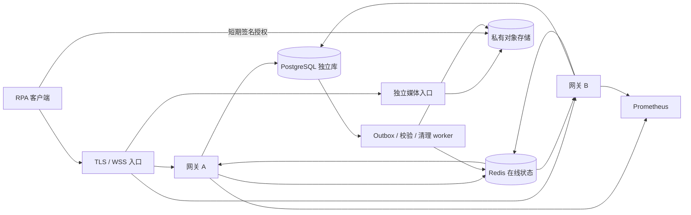

# v0.3.0 网关运行与验收

本版实现多实例、Redis 在线状态、事务 outbox、对象存储、独立媒体/后台进程、流控、Prometheus 指标与告警、图片保留清理。现有 Mac/Windows RPA 尚未切换到网关。

## 组件及可靠性边界



- PostgreSQL 与 Chatwoot 共用实例，仍用独立 `rpa_gateway` 数据库、独立账号。两网关各最多 4 个连接，媒体进程最多 4 个，worker 最多 2 个；账号上限 16。每条长连接不会占用一个 PostgreSQL 连接。
- Redis 用独立服务/namespace，心跳 TTL 45 秒，建议 15 秒一次带随机偏移。心跳更新不逐条写 PostgreSQL。鉴权摘要短期缓存 20 秒，但领取、提交、回执、媒体授权和同步都会在 PostgreSQL 重新校验凭证和会话；缓存不能授权已撤销设备提交。
- 同设备领取、提交、确认依然采用设备行锁及单活动任务唯一约束。Redis 只承载就绪状态和提示，不是任务账本或提交锁。
- 每次任务转换与 outbox 同事务提交。后台 publish 后才标记 outbox 已投递；崩溃可能产生重复提示，不能产生重复执行。Redis 中断会保留未发布记录。
- 每实例只有一个 Redis 订阅器；每连接一个容量为 1 的合并通知槽。空闲连接不再每秒查库。每 25～30 秒按实例批量验证连接凭证和 revision，仅对变化设备补同步，重订阅时立即补同步；客户端也能用 `/v1/device/sync` 拉取当前任务与设备 revision。
- revision 由设备行锁串行递增，不把可能乱序提交的全局 sequence 充当无丢失游标。通知是同步提示，领取才获得租约。
- Redis 故障：新派发与新的 `submitting` 暂停，已提交回执和官方存档核验仍能落 PostgreSQL。数据库故障返回不可用，不返回伪成功。连接池取连接前检查连接，恢复时不恢复旧任务快照。

## 原图传输

生产入口把旧的原始图片上传/下载路径转发给独立媒体服务，控制网关不承担原图流量。新客户端推荐完整直传流程：

1. backend 请求 `POST /v1/backend/{tenant}/media/uploads`，提交 sha256、md5、size。
2. 得到 5 分钟的单对象 presigned POST。上传条件限制最大字节数，临时对象键含随机 upload ID。
3. 上传完成调用 `/complete`。此时还不能把 upload ID 用作 media ID。
4. worker 下载临时对象，检查实际图片格式、解码、像素、字节数和两个哈希；通过后写入单独不可覆盖的原图对象，状态置 ready，返回 media ID；失败置 rejected，不派发。
5. 创建图文任务时只接受已验证 media ID。
6. 设备领取后请求 `GET /v1/device/tasks/{task}/media/{media}/download`，得到 120 秒的指定对象签名 URL。SDK 直接下载并核验不可变任务清单的 SHA256/size，设备 bearer 不发到对象存储。

原图内容按实际字节识别 PNG/JPEG，不重编码。临时对象与最终对象键分离，临时授权不能篡改已验证原图。兼容下载代理保留，但在媒体进程运行。

已签发的对象 URL 是短期 bearer capability，撤销设备不能让已签出的 URL 立即失效，最多保留到 120 秒到期。若需要即时撤销，在独立媒体鉴权代理下载，不给设备签名链接。

默认独立 SeaweedFS 提供 S3 接口；也支持把 object_config 指向私有 AWS S3/兼容对象存储。对象存储当前与入口同宿主机，是流量和进程分离，并非异地容灾。试运行卷数上限 32、单卷目标 256 MiB，名义约 8 GiB（不含元数据），避免无限占用业务主机；这不是千台真实业务 30 天原图的空间承诺，正式规模需独立存储或 OSS/S3 扩容。

## 接入、限流和重连

- 每设备最多两个跨实例通知连接，Redis 保存实例/连接租约，断线未释放的租约 90 秒过期，允许一次重连重叠但防止单设备耗尽全部连接。
- 每实例上限 3000 个认证 socket，ASGI 并发容量 4096，HTTP 同时处理 64 个，媒体进程另限 8 个请求；提升连接数不会取消媒体大小和并发限制。
- Redis token bucket 在实例间共享：设备 10 次/秒、突发 30；租户 500 次/秒、突发 1000；backend 每租户 50 次/秒、突发 100。超过返回 429 和 Retry-After，客户端保持原幂等键后重试。
- 控制请求体上限 256 KiB，图片原始入口 12 MiB；单任务最多 9 图、总计 50 MiB；直接上传授权限制大小，服务端仍重新验实际字节。
- SDK 通知迭代器支持指数退避、全随机抖动、Ping/Pong、低频补同步。重连只恢复握手/同步，绝不自动 claim/Enter。桌面适配器继续负责本地持久提交日志与进程互斥。
- Nginx 用 Docker DNS 动态解析上游，避免容器重建后的旧 IP 缓存；不隐式重试任务 POST/回执，WSS 空闲超时 90 秒；应用 75 秒收不到文本 ping 结束连接。应用支持优雅关闭，客户端断线后换实例恢复。

## 指标、告警和查看

- 每网关 `/metrics` 必须带 admin bearer，标签只含 route 模板、方法、状态码，不含运单、设备、群或密钥。
- 指标覆盖请求耗时/错误、连接数、通知合并、事件循环延迟、数据库池等待、Redis、outbox 条数/最老年龄、unknown/queued、worker 更新时间、进程峰值 RSS/FD、运行盘剩余空间、对象存储就绪、媒体校验排队/耗时。
- Prometheus 配置见 `deploy/prometheus.yml`，告警规则见 `deploy/alerts.yml`：不可用、Redis 故障、通知积压、待核对任务、P95 延迟、事件循环阻塞、错误率、worker 停止、磁盘空间。
- Prometheus 默认仅监听服务器 `127.0.0.1:31090`，存 7 天、上限 256 MB。规则会在本地计算告警；没有向企微/邮件/Slack 发通知，也未配置外部 Alertmanager 接收人。

## 保留与清理

- 原图默认保留 30 天，只清理足够旧、没有 queued/leased/submitting/submitted/unknown 任务引用、最近无使用的图。unknown 的图片不会被清理。
- 清理数据库引用时先事务写入 object GC，再删除对象，失败可重试。对象数据库关系缺失时有 24 小时宽限的分批孤儿扫描；对象上传成功但数据库提交确认丢失时不会直接删除对象。
- staging 授权 5 分钟，超时丢弃；验证失败入 GC；对象存储 staging 生命周期一天清理，避免放弃上传无限累积。
- 任务幂等身份、提交状态、回执事件 ID 与官方存档唯一引用保留；终态超过 365 天的事件详情脱敏，保留原详情摘要；不删除后再让同一请求重新执行。已投递 outbox 保留 7 天。
- 每次清理写 retention_audit，所有批次有数量限制。备份使用 PostgreSQL pg_dump 加对象存储备份/版本策略，不回退旧数据库自动重放。

## 部署和安全访问

部署文件 `deploy/scale.compose.yaml` 使用独立 Compose 项目 `qunl-rpa-gateway-scale`，加入原网关专用网络。不会加入 Chatwoot 应用网络或重启其服务。

| 服务器回环端口 | 用途 |
| --- | --- |
| 31080 | 保留原本机 HTTP 入口 |
| 31443 | 网关 HTTPS/WSS |
| 31444 | 对象存储 HTTPS |
| 31090 | Prometheus |

没有新增公网开放或域名。试运行 TLS 证书仅含 localhost/127.0.0.1，私钥独立保管，未加入系统信任库。远程试用需 SSH 转发这些端口并显式信任这张证书；正式接入应配置可信域名证书及对应 object_config.public_endpoint。

```bash
ssh -N -L 31443:127.0.0.1:31443 -L 31444:127.0.0.1:31444 -L 31090:127.0.0.1:31090 chatwoot-prod
```

查看：

```bash
cd /opt/ai/rpa-gateway
docker compose -f deploy/scale.compose.yaml ps
docker compose -f deploy/scale.compose.yaml logs --tail 50 worker
```

不要在外置原图后退回旧 0.2.0 代码或旧数据库，否则旧程序不知道对象存储。故障回退保持 0.3.0 的账本和原图，把新流量收敛到一个健康实例；未知任务先核对，不复制重跑。两实例同宿主机提供进程冗余，宿主机故障仍会影响全部，跨主机部署另行配置。

## 验收方法和已知边界

- `tests/` 使用本机专用 PostgreSQL 测试库、独立 schema、Redis namespace 和 S3 模拟服务，包含故障与清理场景。
- `scripts/start_local_scale.py` 启动两个真实网关、独立媒体/worker、Nginx TLS 入口，绝不连接 Chatwoot 数据源。
- `scripts/load_scale.py` 支持 clients/seconds/task-seconds 等参数，实建每设备凭证和连接，采集完整任务及通知指标；固定只允许回环性能环境。压力测试不能针对共享业务主机。
- `scripts/fault_scale.py` 只操作自行创建的本地进程、Redis 和 PostgreSQL，验证跨实例通知、节点重启、Redis/DB 故障和提交记录恢复。
- 压测 JSON 的 passed 表示连接、任务计数和无请求错误；延迟 SLO 必须另看 P95/P99，不能把两千台连接正确性通过写成全部性能达标。
- 千台/两千台短时连接通过不能代替 1 小时和 24 小时 soak，更不能保证真实企业微信上传或官方存档延迟。长时间运行测试可通过增大 seconds 执行；本次报告应明确实测时长和负载机同机的局限。
